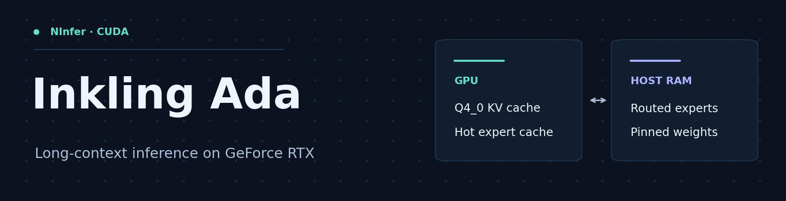
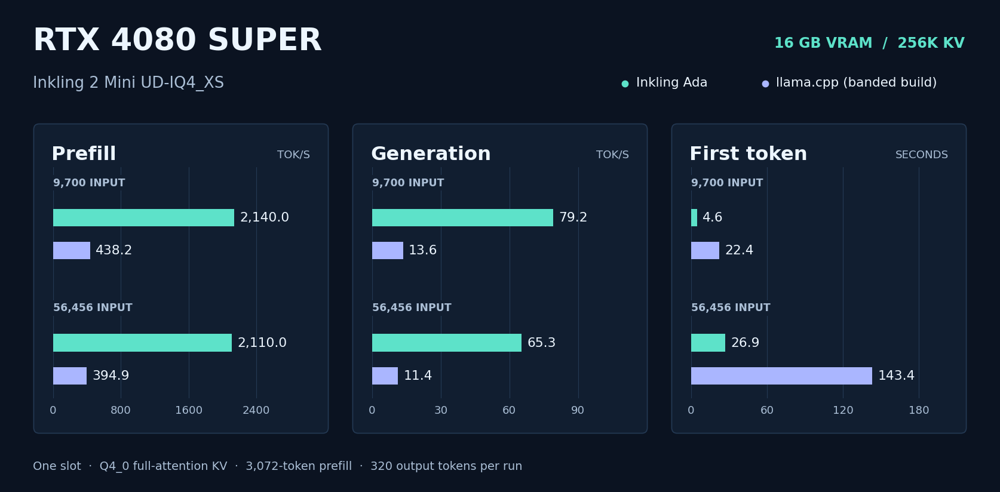
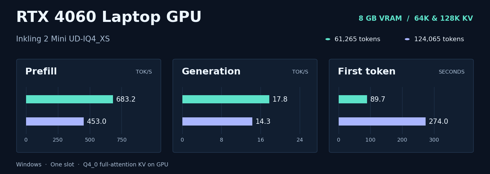

<p align="center">
  
</p>

<p align="center">
  <strong>Inkling 2 Mini on one Ada GPU.</strong>
  256K on the 16 GB RTX 4080 SUPER and up to 128K on the 8 GB RTX 4060 Laptop GPU.
</p>

<p align="center">
  <a href="#benchmarks">Benchmarks</a> ·
  <a href="#quick-start">Quick start</a> ·
  <a href="#implementation">Implementation</a> ·
  <a href="https://github.com/DennerBlack/ninfer-inkling-ada/releases">Releases</a>
</p>

## Benchmarks

All timed profiles used **Inkling 2 Mini UD-IQ4_XS**, one slot and Q4_0 full-attention KV on the GPU. The desktop profiles use the same two text requests. The laptop tests retrieve three exact records. [Methodology and weight hashes](docs/inkling-ada-benchmarks.md)

### RTX 4080 SUPER · 16 GB



<details>
<summary>Results and test settings</summary>

| Engine | KV capacity, tokens | Input tokens | Prefill, tok/s | Generation, tok/s | TTFT, s |
| :--- | ---: | ---: | ---: | ---: | ---: |
| Inkling Ada | 262,144 | 9,700 | 2,140.0 | 79.2 | 4.6 |
| llama.cpp banded | 262,144 | 9,700 | 438.2 | 13.6 | 22.4 |
| Inkling Ada | 262,144 | 56,456 | 2,110.0 | 65.3 | 26.9 |
| llama.cpp banded | 262,144 | 56,456 | 394.9 | 11.4 | 143.4 |

Windows · Core i7-12700F · 64 GB RAM · 3,072-token prefill chunks. Each run generated 320 tokens with zero prefix-cache hits. Both builds enabled DSpark with up to two proposals and three-token n-gram lookup. [Exact configurations](docs/inkling-ada-benchmarks.md#desktop-engine-comparison)

</details>

The chart pairs the original Inkling Ada measurements with a run of a locally patched llama.cpp banded build. Both completed the same workloads at 256K Q4_0 full-attention KV. Sliding-window KV precision, GPU expert cache size and DSpark acceptance settings differed.

On this system, released llama.cpp allocated the requested KV before hitting the Windows commit guard during startup. NInfer-all rejected Q4_0, and Strata selected FP8 with a 37,184-token window. [Engine versions and launch results](docs/inkling-ada-benchmarks.md#desktop-engine-comparison)

### RTX 4060 Laptop GPU · 8 GB



<details>
<summary>Results and test settings</summary>

| Engine | KV capacity, tokens | Input tokens | Prefill, tok/s | Generation, tok/s | TTFT, s |
| :--- | ---: | ---: | ---: | ---: | ---: |
| Inkling Ada | 65,536 | 61,265 | 683.2 | 17.8 | 89.7 |
| Inkling Ada | 131,072 | 124,065 | 453.0 | 14.3 | 274.0 |

Windows · Core i7-13700H · 32 GB RAM · 2,560-token prefill chunks and tiled Q4_0 decode. The model returned all three requested records in both runs. [Laptop launch settings](docs/inkling-ada-laptop.md)

</details>

### RTX 5070 Laptop GPU · 8 GB

| Engine | KV capacity, tokens | Input tokens | Prefill, tok/s | Generation, tok/s | TTFT, s |
| :--- | ---: | ---: | ---: | ---: | ---: |
| Inkling Ada | 65,536 | 61,265 | 903.1 | 20.1 | 67.9 |
| Inkling Ada | 131,072 | 124,065 | 613.0 | 16.4 | 202.4 |

Windows · Q4_0 KV · 2,560-token prefill chunks. Both runs retrieved all three requested records in order. [RTX 5070 laptop benchmark report](docs/inkling-ada-rtx-5070-laptop.md)

## Quick start

### 1. Build the server

Open an x64 Developer PowerShell with MSVC, CUDA, CMake, Ninja, and vcpkg. Put CUDA on `PATH` and point `VCPKG_ROOT` at your vcpkg installation. [Windows build guide](docs/build-windows.md)

```powershell
cmake -S . -B build-ada -G Ninja -DCMAKE_BUILD_TYPE=Release `
  "-DCMAKE_TOOLCHAIN_FILE=$env:VCPKG_ROOT/scripts/buildsystems/vcpkg.cmake" `
  -DVCPKG_TARGET_TRIPLET=x64-windows -DCMAKE_CUDA_ARCHITECTURES=89
cmake --build build-ada --target ninfer-serve
```

### 2. Download the model

The WaveCut package includes UD-IQ4_XS text weights, Q8_0 vision, and a DSpark drafter. The download is 16.5 GB. [Model card](https://huggingface.co/WaveCut/Inkling-2-Mini-UD-IQ4_XS-NInfer-v3)

```powershell
hf download WaveCut/Inkling-2-Mini-UD-IQ4_XS-NInfer-v3 `
  Inkling-2-Mini-UD-IQ4_XS-ninfer-v3.ninfer `
  --revision 50d6ad60cfcd170633ead778e3a09958fc1e7887 --local-dir models
```

### 3. Start a local server

The Ada profile uses one slot and runs KV, vision, and DSpark on the GPU. Routed experts live in pinned host RAM with a GPU cache. Lower `--expert-cache-mib` if the GPU has less memory available at startup.

```powershell
$inklingFlags = @(
  'ATTENTION_GRAPHS', 'FUSED_EXPERTS', 'EXPERT_GRAPHS', 'LEND_WORKSPACE',
  'VERIFY_PAIRS', 'ROUTE_GRAPHS', 'PROMOTE_LOCAL', 'COPY_EVENT',
  'SPARSE_STAGES', 'REUSE_ROUTE_BOUNDS'
)
foreach ($flag in $inklingFlags) {
  [Environment]::SetEnvironmentVariable("HEL_INKLING_$flag", '1', 'Process')
}
$env:HEL_INKLING_PROMPT_MMA = '3'
$env:HEL_INKLING_EXPERT_CACHE_CEILING = '1'
$env:HEL_INKLING_ALLOCATION_RESERVE_MIB = '300'

.\build-ada\apps\ninfer-serve.exe .\models\Inkling-2-Mini-UD-IQ4_XS-ninfer-v3.ninfer `
  --model-id inkling-2-mini --host 127.0.0.1 --port 8080 --no-webui `
  --max-context 262144 --kv-capacity 262144 --max-concurrency 1 --kv-dtype q4_0 `
  --expert-residency host --embedding-residency host --expert-cache-mib 5663 `
  --expert-dma-share 1 --prefill-chunk 3072 --vision `
  --spec dspark --draft-tokens 2 --draft-min-p 0.5 --adaptive-mtp --lookup-ngram 3 `
  --host-cache-mib auto --host-cache-max-mib 7168 --host-cache-reserve-mib 2048
```

Send a request from a second terminal.

```powershell
$request = @{
  model = 'inkling-2-mini'
  messages = @(@{ role = 'user'; content = 'Describe Saturn in one sentence.' })
  max_tokens = 128
} | ConvertTo-Json -Depth 4
Invoke-RestMethod 'http://127.0.0.1:8080/v1/chat/completions' `
  -Method Post -ContentType 'application/json' -Body $request
```

## Implementation

- Q4_0 KV storage for full attention in both Inkling and its drafter. Sliding-window attention uses F16.
- Ada CUDA kernels and graph capture for attention and expert routing, with asynchronous transfers between host RAM and the GPU expert cache.
- Smaller host snapshots for edited conversations. In a four-request A/B test, the compact path saved 208 MiB of host cache and produced identical text streams.

## Credits

Engine based on [NInfer-all 2026-11-21.4](https://github.com/iamwavecut/ninfer-all/releases/tag/2026-11-21.4) · [Upstream documentation](README.upstream.md) · [Apache-2.0](LICENSE)

Inkling 2 Mini by Thinking Machines Lab · [Quantization by Unsloth](https://huggingface.co/unsloth/Inkling-2-Mini-GGUF) · [NInfer package by WaveCut](https://huggingface.co/WaveCut/Inkling-2-Mini-UD-IQ4_XS-NInfer-v3)
